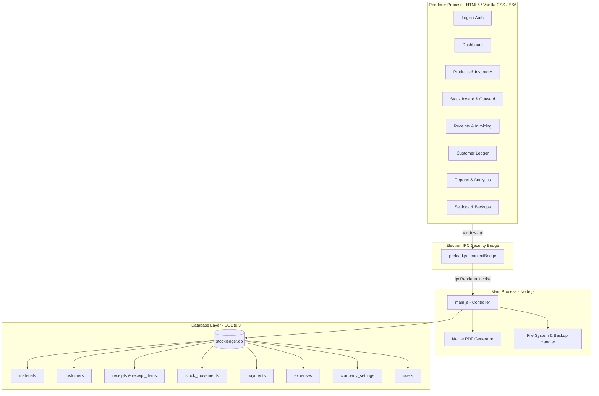
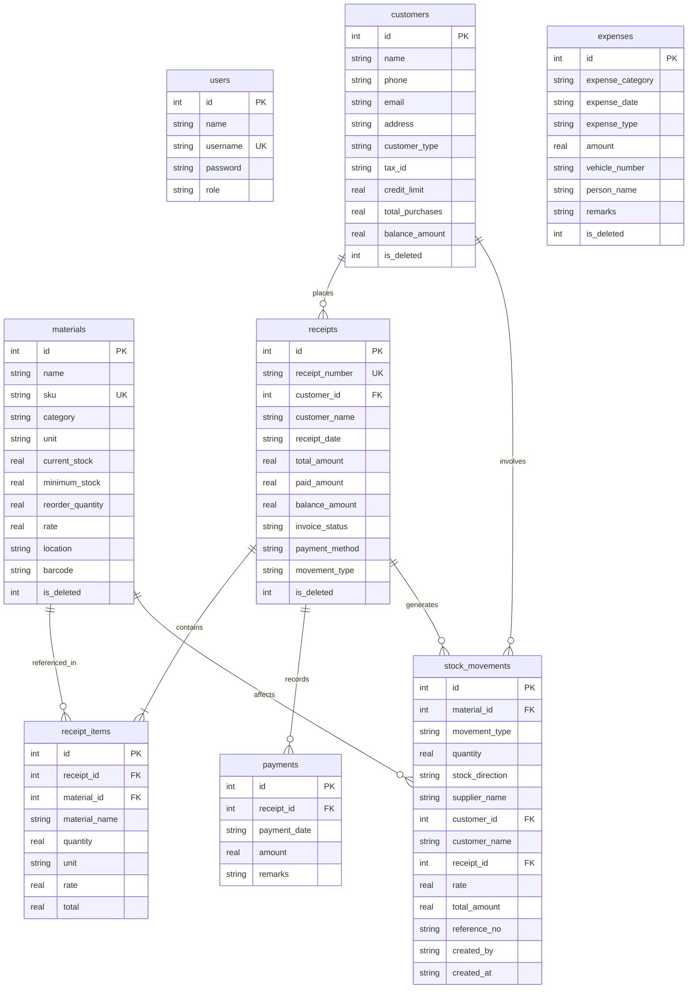

# StockLedger — Inventory Management System

[](https://www.electronjs.org/)
[](https://nodejs.org/)
[](https://www.sqlite.org/)
[](https://github.com/)

A modern, desktop-first enterprise inventory management, billing, and accounting ledger application engineered for multi-category wholesale, manufacturing, and retail trade businesses. Built with **Electron**, **SQLite 3**, and modern vanilla web standards, **StockLedger** provides offline-first reliability, instant POS billing, automated invoice PDF rendering, real-time stock tracking, and complete audit logging.

---

## 🌟 Key Capabilities & System Features

### 1. Executive Dashboard
- **Real-Time KPIs**: Monitor total units in stock, low-stock threshold alerts, today's sales revenue, outstanding receivables, daily operational expenses, and total invoices generated.
- **Dynamic Alerts**: Automated banner notification when any product falls below its minimum reorder point with instant navigation to restock workflows.
- **Live Activity Feeds**: Real-time previews of latest sales receipts, top inventory products by volume, and the 10 most recent stock movements.

### 2. Products & Inventory Management
- **SKU & Barcode Support**: Automated and custom SKU tracking (`SKU-ELEC-1001`, `SKU-RAW-3001`), warehouse storage location bins (e.g. `Bay A-1`, `Rack R-2`), and reorder batch thresholds.
- **Multi-Category Hierarchy**: Built-in support for Electronics, Hardware, Raw Materials, Packaging, Consumables, and Spare Parts.
- **Real-Time Stock Updates**: Stock levels automatically adjust upon receipt generation or inward delivery, preventing overselling with strict concurrency checks.

### 3. Stock Inward (Procurement & Deliveries)
- Record incoming supplier shipments, purchase invoices, delivery vehicle numbers, and batch notes.
- Automatically generates audited inward ledger entries and increments product quantities within transactional boundaries.

### 4. Sales & Dispatch (POS & Stock-Out)
- Multi-item line entry with instant itemized totals, quantity checks against available inventory, and real-time balance calculations.
- Support for direct customer selection, partial down-payments, and automatic customer ledger updates.
- Generates official numbered invoices (`RCP-YYYY-XXXXX`) upon submission.

### 5. Invoices & Receipts Center
- Search, filter, and review historical invoices.
- **Instant Printable Invoices**: Generates clean, printer-friendly tax invoices and receipts with company branding and detailed payment history.
- **Direct PDF Export**: Native Electron PDF printer saves invoices directly to disk.
- **WhatsApp Integration**: One-click sharing formatted for WhatsApp Web with pre-populated order summaries.
- **Partial Payment Tracking**: Collect outstanding balances directly on historical receipts with instant receipt re-calculation.

### 6. Customer Accounts Ledger
- Complete customer directory tracking total lifetime purchases, unpaid balances, tax IDs, credit limits, and contact details.
- Modal-based payment receipt module that records partial settlements against open invoices.

### 7. Stock Movement History & Audit Log
- Immutable chronological transaction ledger tracking every stock change (`Stock In`, `Stock Out`, `Adjustment`).
- Filter by date range, movement direction, counterparty, or product name.

### 8. Unified Expense Tracker
- Comprehensive operational expense ledger categorized by **Supplier Procurement**, **Fleet & Logistics**, and **Personnel & Facilities**.
- Dedicated tracking for vehicle fleet fuel and road transit expenses.

### 9. Business Reports & Analytics
- Modular reporting module with live filtering across custom date ranges:
  - **Sales Report**: Revenue, units sold, collections, and outstanding receivables.
  - **Stock Report**: Audit balance and movement breakdowns.
  - **Receipts Report**: Invoice ledger with customer contact metadata.
  - **Expense Report**: Category totals across procurement, fleet, and overhead.
  - **Customer Report**: Top accounts by purchase volume and debt.
  - **Low-Stock Report**: Critical inventory reorder list.
- One-click print export optimized for reporting layouts.

### 10. System Health & Database Administration
- **Automated SQLite WAL Mode**: High-performance concurrent reads and writes with SQLite Write-Ahead Logging.
- **One-Click Backup & Restore**: Full transactional database backup to user-selected locations, with integrity verification and automatic safety snapshots prior to database restoration.
- **Role-Based Authentication**: Secure bcrypt password hashing with session persistence.

---

## 🏗 System Architecture



---

## 🗄 Database Schema Design

The SQLite database is normalized, strictly indexed, and supports foreign key constraints:



### Indexed Columns for Query Optimization
- `idx_materials_sku` on `materials(sku)`
- `idx_materials_category` on `materials(category)`
- `idx_materials_name` on `materials(name)`
- `idx_stock_movements_mat` on `stock_movements(material_id)`
- `idx_stock_movements_date` on `stock_movements(created_at)`
- `idx_stock_movements_receipt` on `stock_movements(receipt_id)`
- `idx_receipts_customer` on `receipts(customer_id)`
- `idx_receipts_date` on `receipts(receipt_date)`
- `idx_receipts_number` on `receipts(receipt_number)`
- `idx_receipt_items_receipt` on `receipt_items(receipt_id)`
- `idx_customers_phone` on `customers(phone)`
- `idx_customers_name` on `customers(name)`

---

## 🎨 UI/UX Design System

The visual identity of StockLedger follows modern SaaS and desktop software design principles:
- **Palette**: Deep slate-navy sidebar (`#0f172a`), crisp white surfaces (`#ffffff`), and subtle canvas background (`#f8fafc`).
- **Accents**: Modern cobalt blue primary (`#2563eb`), emerald green for healthy stock & profits (`#059669`), crimson for low-stock and debt alerts (`#dc2626`), and warm amber for pending actions (`#d97706`).
- **Typography**: Paired with modern typefaces (`Plus Jakarta Sans` for headers, `Inter` for data tables, and `Outfit` for numerical metrics).
- **Interactive Feedback**: Hover-activated action buttons in data tables, smooth CSS cubic-bezier modals, and responsive layout grids.

---

## 💻 Tech Stack

- **Runtime**: [Electron](https://www.electronjs.org/) (v42.x)
- **Engine**: [Node.js](https://nodejs.org/) (v24.x)
- **Database**: [SQLite 3](https://github.com/TryGhost/node-sqlite3) (v6.x) with native WAL & foreign keys
- **Security**: [bcryptjs](https://github.com/dcodeIO/bcrypt.js) password hashing & context-isolated IPC
- **Packaging**: [Electron Forge](https://www.electronforge.io/)
- **Frontend**: Vanilla ES6 JavaScript, HTML5, Modern CSS3 custom properties

---

## 🚀 Getting Started

### Prerequisites
- Node.js (v18.x or newer recommended; tested on v24.x)
- npm (v9.x or newer)

### Installation
1. Clone or download the repository:
   ```bash
   git clone https://github.com/your-username/stockledger-inventory-system.git
   cd stockledger-inventory-system
   ```

2. Install dependencies:
   ```bash
   npm install
   ```

3. Launch the application in development mode:
   ```bash
   npm start
   ```

### Default Demo Credentials
When launching the application for the first time, an administrator account is automatically initialized:
- **Username**: `admin`
- **Password**: `admin123`

*(You can create additional user accounts and roles via the User Management panel)*

### Package as Desktop Installer
To build a production standalone installer:
```bash
npm run make
```
The output package will be generated inside the `out/make/` directory.

---

## 📁 Project Directory Structure

```text
├── assets/
│   ├── logo.ico               # Desktop application window icon
│   └── logo.png               # High-resolution StockLedger branding logo
├── css/
│   └── style.css              # Modern design system & responsive UI rules
├── database/
│   ├── database.js            # SQLite connection, schema migrations, and helper queries
│   └── stockledger.db         # Local SQLite database file (runtime generated)
├── js/
│   ├── admin.js               # Dashboard metrics and live feed controllers
│   ├── common.js              # Shared toast notifications, escape helpers, and formatting
│   ├── customers.js           # Customer accounts, balance calculation, and history
│   ├── expenses.js            # Procurement, fleet, and staff expense management
│   ├── login.js               # Authentication and session handling
│   ├── materials.js           # Product catalog, SKU management, and stock filters
│   ├── receipts.js            # Invoicing, receipt modal rendering, and PDF generator
│   ├── reports.js             # Analytics, report generation, and CSV/print outputs
│   ├── settings.js            # Company settings, database backups, and health checks
│   ├── stock.js               # Stock inward recording and delivery notes
│   ├── stock-movements.js     # Transaction ledger and historical movement filters
│   ├── stock-out.js           # POS sales dispatch, line items, and receipt creation
│   └── users.js               # User management and access control
├── pages/
│   ├── add-stock.html         # Inward delivery entry
│   ├── admin-dashboard.html   # Main executive KPI dashboard
│   ├── customers.html         # Customer ledger and receivables
│   ├── expenses.html          # Operational expense tracker
│   ├── login.html             # Secure login & signup interface
│   ├── materials.html         # Product & SKU management directory
│   ├── receipts.html          # Invoices & receipts repository
│   ├── reports.html           # Business reporting center
│   ├── settings.html          # Company branding and database backup/restore
│   ├── stock-movements.html   # Stock history and audit ledger
│   ├── stock-out.html         # POS sales and dispatch form
│   └── users.html             # User account administration
├── forge.config.js            # Electron Forge packaging configuration
├── main.js                    # Electron main process, IPC handlers, and window lifecycle
├── package.json               # Project manifest, scripts, and dependencies
├── preload.js                 # Context-isolated secure API bridge
└── README.md                  # System documentation and portfolio guide
```

---

## 🛡️ License & Attribution

This project is released under the [ISC License](LICENSE). Designed and developed as a distinct, enterprise-grade inventory management portfolio showcase. All demo data, company identities, and product catalogs are synthetic.